# CncMes — Job Tracking for Small CNC Workshops

A desktop MES/ERP application for small CNC machining shops. It covers the whole flow of a job: a customer brings a 3D model (STL), the app measures the part and produces an itemized price quote, the order becomes a job assigned to an operator, and when the job is finished the actual costs are recorded and reported as profit/loss.

Built as my 3rd-year term project in Computer Engineering at Konya Technical University (Spring 2026).

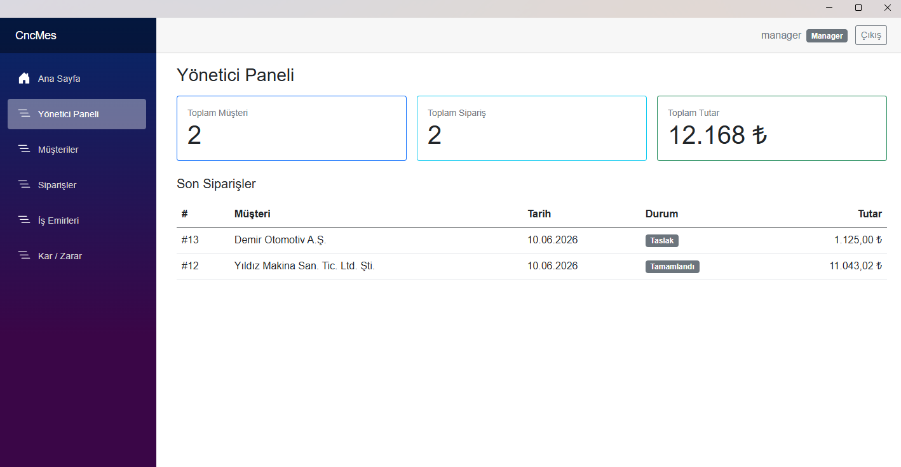

## Features

- **Role-based access** with three roles: Admin, Manager and Operator. Operators only see their own jobs, and prices and costs are never sent to the operator views.
- **Customers and orders**: create orders with multiple line items and track each order's status.
- **STL analysis**: computes volume, surface area, bounding box, aspect ratio and a watertight check directly from the mesh, in plain C#.
- **Itemized pricing**: material (with a waste factor), labor, machine time, setup (spread across the order quantity), surface finish and heat treatment. Every coefficient can be edited by an admin.
- **Jobs and the operator panel**: assign jobs to operators. Operators start and finish their work from their own panel.
- **Material stock**: stock is deducted automatically when a job finishes, with low-stock warnings.
- **Profit/loss**: material, labor, electricity and tool-wear costs are recorded per job. Reports are available monthly and per order, with PDF export.

## Tech stack

| | |
|---|---|
| Language / runtime | C#, .NET 8 |
| UI | .NET MAUI Blazor Hybrid (Windows desktop) |
| Data | Entity Framework Core + SQLite |
| Auth | ASP.NET Core Identity (local user store, in-process auth state) |
| STL parsing | [IxMilia.Stl](https://github.com/ixmilia/stl) |
| PDF reports | [QuestPDF](https://www.questpdf.com/) |

## Architecture

A layered monolith with four projects. Each layer depends only on the layers below it:

```
src/
├── CncMes.Domain          Entities and constants (no dependencies)
├── CncMes.Application     DTOs, request models, service interfaces
├── CncMes.Infrastructure  EF Core DbContext, migrations, service implementations,
│                          STL geometry, pricing, PDF reports
└── CncMes.App             MAUI Blazor Hybrid UI (Razor pages per role)
```

The UI only talks to Application interfaces. The Infrastructure layer implements them and is registered through dependency injection in `MauiProgram.cs`.

## Getting started

Requirements: Windows 10/11, the .NET 8 SDK and the MAUI workload.

```powershell
dotnet workload install maui-windows
dotnet build
dotnet run --project src/CncMes.App -f net8.0-windows10.0.19041.0
```

On first launch, the app creates the SQLite database under the app data folder, applies the migrations and seeds the demo data.

**Demo users** (password for all: `Admin!23`)

| User | Role |
|---|---|
| `admin` | Admin |
| `manager` | Manager |
| `operator`, `operator2` | Operator |

Sample STL files for trying out the analysis are in [`test_data/`](./test_data).

## Screenshots

| | |
|---|---|
| 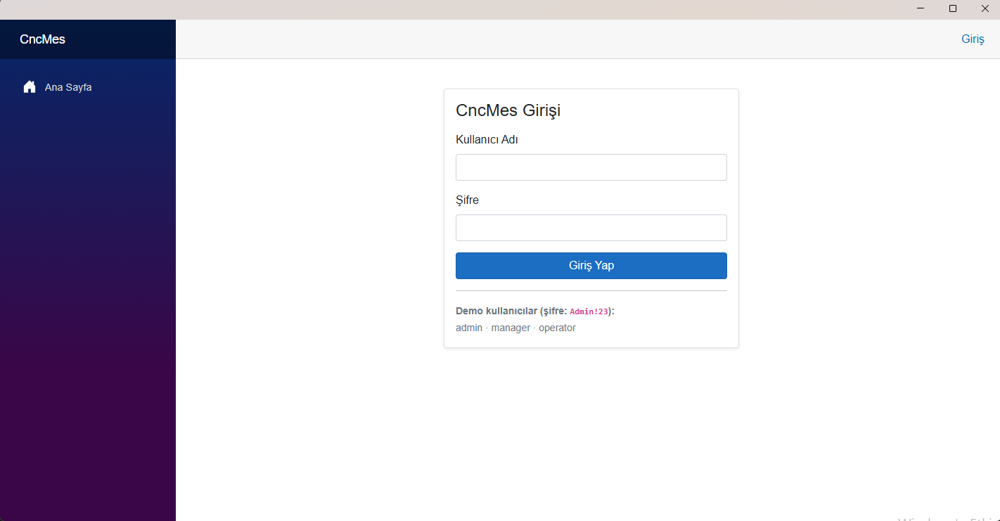 Login | 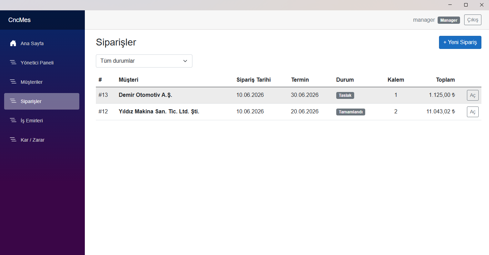 Orders |
| 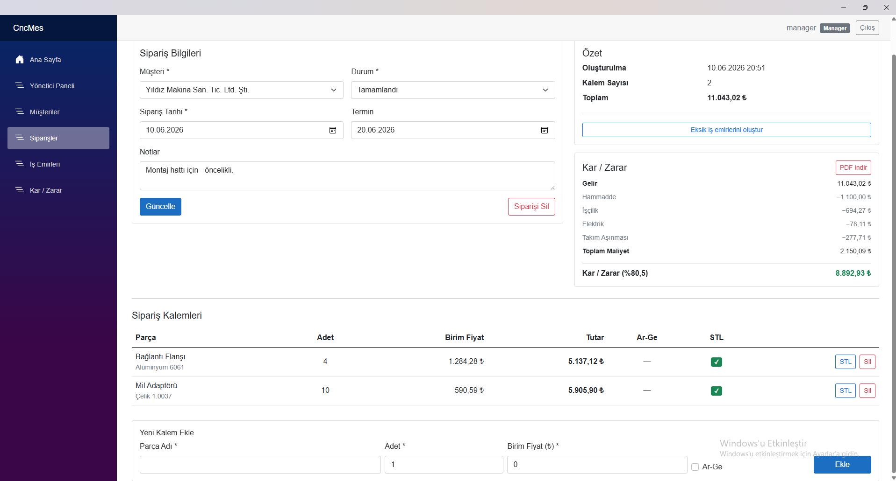 Order detail with profit/loss | 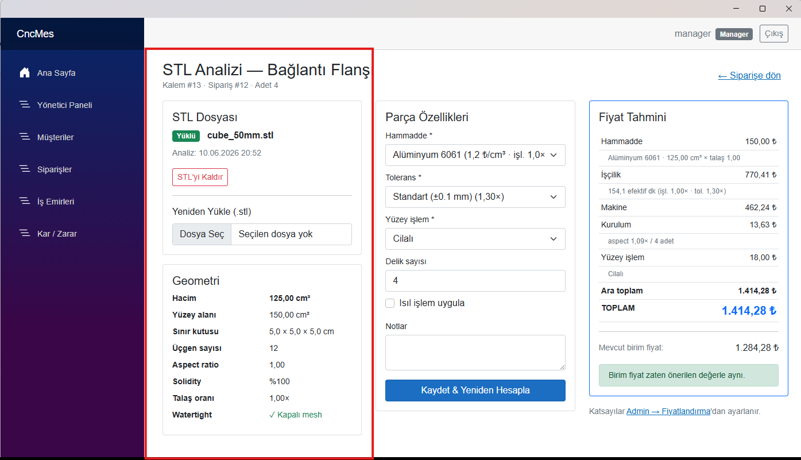 STL analysis and price breakdown |
| 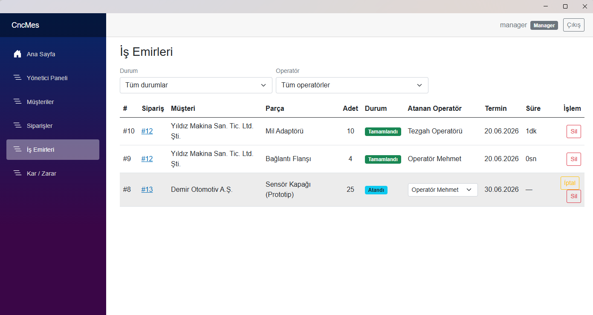 Job assignment | 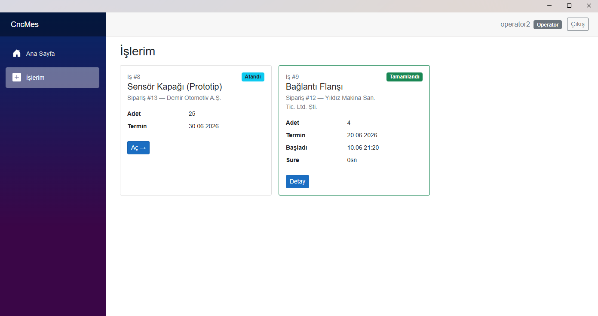 Operator panel |
| 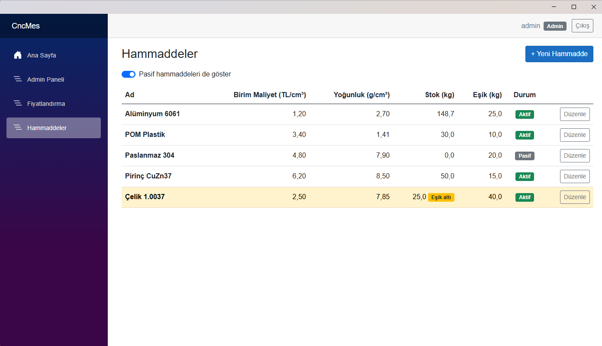 Material stock | 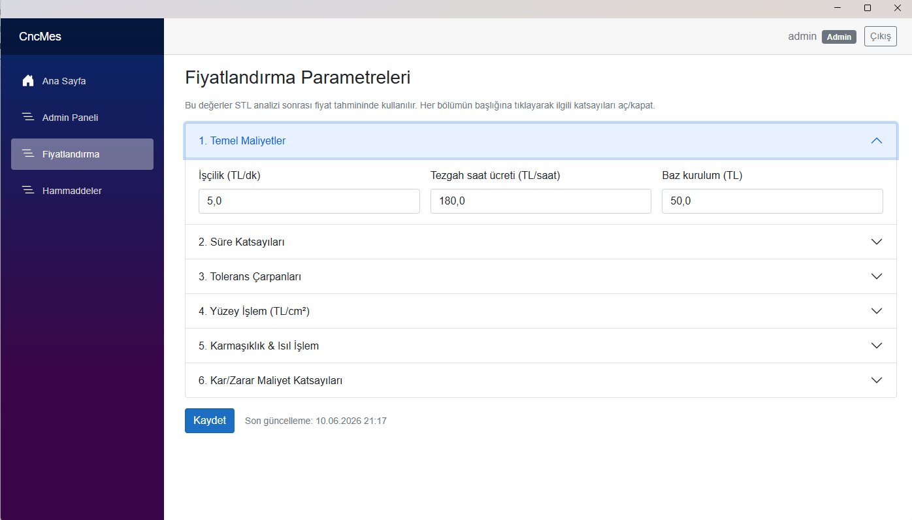 Pricing settings |
| 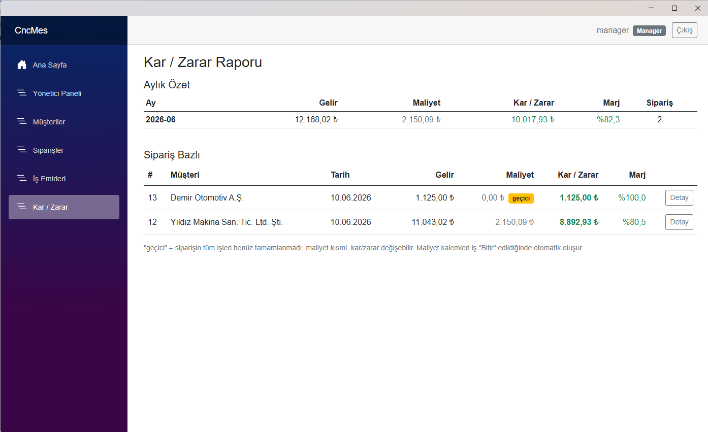 Profit/loss report | 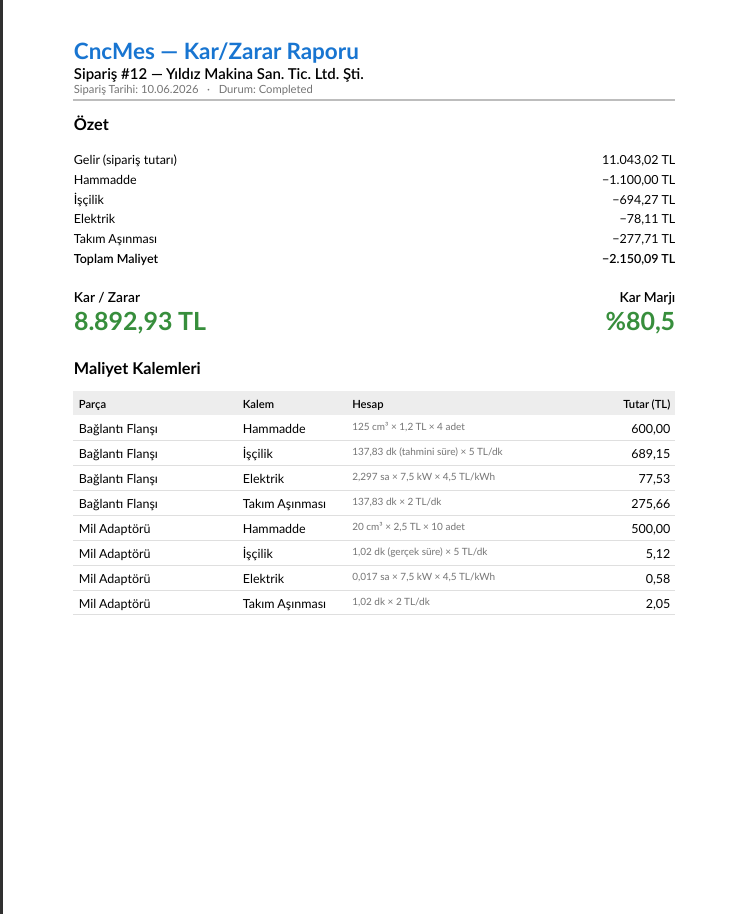 Exported PDF |

The UI is in Turkish.

## Limitations

- Only STL files are supported (no STEP/IGES).
- Machining time is estimated from geometry with simple coefficients. It is not a CAM simulation.
- The app is single-machine and single-user: a local SQLite file, with no server.

## About AI assistance

I used Claude Code as a coding assistant during development. The requirements, domain rules, architecture decisions and testing are my own work.
